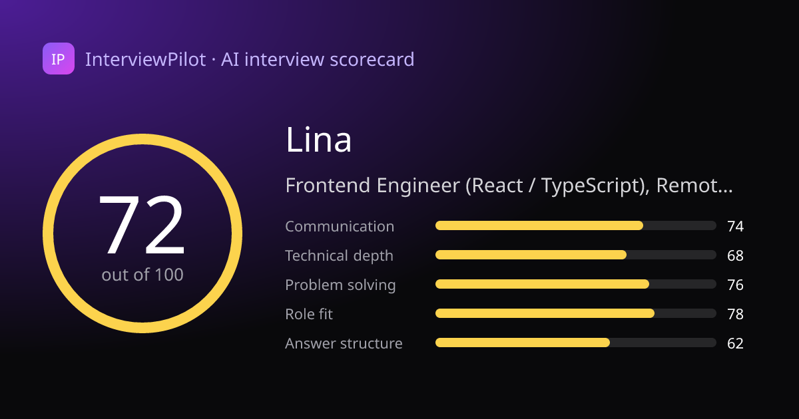
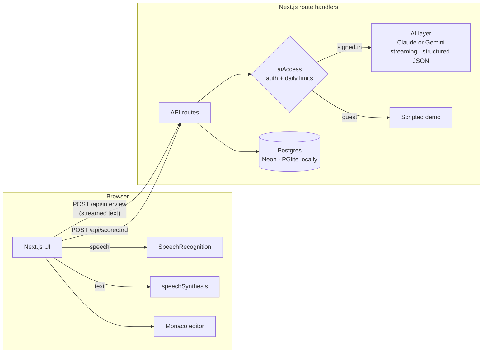

# InterviewPilot

**Practice real job interviews out loud with an AI interviewer, then get scored like a hiring manager would score you.**

**🔗 Live: https://interviewpilot-three.vercel.app**

Maya, the AI interviewer, reads your CV and the job post, talks with you by voice, digs deeper when your answers are vague, runs a live coding round, and gives you a detailed scorecard. Every interview is saved to your dashboard so you can track your progress. Works in **English and Arabic**.

[](https://github.com/SireenZo/interviewpilot/actions/workflows/ci.yml)



## Features

| | |
| --- | --- |
| 🎙️ **Voice interview** | Maya speaks her questions and listens to your spoken answers. Her reply streams from the model and starts speaking sentence by sentence before the full reply has arrived. |
| 🧠 **Adaptive questions** | Grounded in your CV and the job; vague answers get follow-ups. Choose **mixed, behavioral or technical**, and **junior, mid or senior**. |
| 💻 **Live coding round** | A job-relevant problem in a Monaco (VS Code) editor with a timer; you explain your approach, then Maya reacts to your solution. |
| 📊 **AI scorecard** | An overall score with a hiring recommendation, a 5-skill radar, per-answer scores, a **stronger rewrite of every answer**, a code review, and a weekly practice plan. |
| 🗣️ **Delivery analytics** | Speaking pace (wpm), filler words in English and Arabic, answer length, talk time. |
| 📈 **Dashboard** | Sign in with GitHub or Google; see your interview history, score trend, and average skills. |
| 🔗 **Shareable scorecards** | Public links with a generated **social preview image** for LinkedIn. The CV is never shown. |
| 🛡️ **Abuse protection** | Guests get a free scripted demo; real AI requires sign-in, with daily per-user limits. |

## Architecture



**Engineering highlights**

- **Streaming speech pipeline**: `useSpeaker` exposes `begin() → feed(chunk) → end()`, speaking complete sentences as they stream in; the mic opens only when the voice finishes, so the AI never hears itself.
- **Prompt caching by design**: the transcript is mapped to Messages API turns that are strictly append-only (each wrapper depends only on the turns before it, which is unit-tested), so the CV and job context stay cached for the whole interview.
- **Server-driven interview flow**: `nextTurnKind()` decides question → coding → closing; the route streams text, or returns the coding task as JSON, with an `X-Turn-Kind` header.
- **Provider-agnostic AI layer** (`src/lib/ai.ts`): one interface (stream a reply, return a typed object, read a PDF) over **Claude** (paid, highest quality) and **Gemini** (free tier). Set either key; a test checks that every schema uses only JSON Schema features Gemini supports.
- **Typed AI outputs**: scorecards and coding tasks are generated against Zod schemas (Claude structured outputs / Gemini `responseJsonSchema`), validated, then normalised (clamped scores, answer feedback realigned to the transcript).
- **One codebase, two databases**: Drizzle ORM on Neon serverless Postgres in production and embedded PGlite locally, so development needs no database install.
- **Security**: strict input validation that keeps only known fields, prompt-injection-aware prompts, owner-scoped queries, unguessable share IDs, and a test login that exists only in development.

## Tech stack

Next.js 15 (App Router) · React 19 · TypeScript · Tailwind CSS 4 · Claude or Gemini (free tier) · Auth.js · Drizzle ORM · Neon Postgres · PGlite · Monaco Editor · Web Speech API · Vitest · GitHub Actions · Vercel

## Run locally

```bash
npm install
cp .env.example .env.local     # then set AUTH_SECRET (openssl rand -base64 32)
npm run dev
```

- Without an AI key, everything runs in **demo mode**. For real AI for free, set `GEMINI_API_KEY` (free at [Google AI Studio](https://aistudio.google.com/apikey)); or set `ANTHROPIC_API_KEY` for Claude.
- Locally you can sign in as a **test user** (development only), and data is stored in `./.pglite`.
- Use **Chrome or Edge** for voice answers.

```bash
npm test            # unit tests
npm run typecheck
npm run lint
npm run db:generate # after changing src/db/schema.ts
```

## Deploy (Vercel)

1. Import the repo on Vercel and add a **Neon** Postgres database from the Storage tab, which sets `DATABASE_URL`.
2. Create a GitHub OAuth app (callback `https://<your-domain>/api/auth/callback/github`) and set `AUTH_GITHUB_ID` and `AUTH_GITHUB_SECRET`. Google is optional.
3. Set `AUTH_SECRET` and an AI key: `GEMINI_API_KEY` (free) or `ANTHROPIC_API_KEY`.
4. Deploy. Migrations run automatically during the build.

---

Built by **[Sireen Alzoughbi](https://github.com/SireenZo)** · Also see **[MatchMyCV](https://github.com/SireenZo/matchmycv)**
